<!-- Generated by `pnpm --filter @tokojojo/api db:docs`; do not edit by hand. Tables, columns, enums, relations, indexes, and PK/FK constraints come from `src/db/schema`. CHECK constraints live in the migrations and tests; views and the append-only guard are documented in README.md. -->

# Tables

| Name                                                  | Columns | Comment |
| ----------------------------------------------------- | ------- | ------- |
| [audit_events](#audit_events)                         | 9       |         |
| [auth_nonces](#auth_nonces)                           | 6       |         |
| [offline_tokens](#offline_tokens)                     | 10      |         |
| [refresh_tokens](#refresh_tokens)                     | 8       |         |
| [sessions](#sessions)                                 | 10      |         |
| [categories](#categories)                             | 4       |         |
| [product_stock_thresholds](#product_stock_thresholds) | 5       |         |
| [product_units](#product_units)                       | 8       |         |
| [products](#products)                                 | 9       |         |
| [device_keys](#device_keys)                           | 11      |         |
| [devices](#devices)                                   | 10      |         |
| [cash_flows](#cash_flows)                             | 12      |         |
| [customers](#customers)                               | 8       |         |
| [users](#users)                                       | 11      |         |
| [cashier_shifts](#cashier_shifts)                     | 15      |         |
| [device_events](#device_events)                       | 6       |         |
| [purchase_items](#purchase_items)                     | 10      |         |
| [purchase_payments](#purchase_payments)               | 7       |         |
| [purchases](#purchases)                               | 12      |         |
| [receipt_settings](#receipt_settings)                 | 7       |         |
| [sale_items](#sale_items)                             | 12      |         |
| [sale_payments](#sale_payments)                       | 11      |         |
| [sale_return_items](#sale_return_items)               | 6       |         |
| [sale_returns](#sale_returns)                         | 11      |         |
| [sales](#sales)                                       | 24      |         |
| [stock_movements](#stock_movements)                   | 12      |         |
| [stock_opname_items](#stock_opname_items)             | 6       |         |
| [stock_opnames](#stock_opnames)                       | 10      |         |
| [stock_transfer_items](#stock_transfer_items)         | 6       |         |
| [stock_transfers](#stock_transfers)                   | 13      |         |
| [store_settings](#store_settings)                     | 11      |         |
| [suppliers](#suppliers)                               | 8       |         |
| [sync_batches](#sync_batches)                         | 8       |         |

---

# Enums

## stock_location

| Value     |
| --------- |
| WAREHOUSE |
| STORE     |

## device_key_status

| Value   |
| ------- |
| ACTIVE  |
| RETIRED |
| REVOKED |

## device_platform

| Value   |
| ------- |
| ANDROID |
| TAURI   |

## device_status

| Value   |
| ------- |
| PENDING |
| ACTIVE  |
| REVOKED |

## cash_flow_type

| Value |
| ----- |
| IN    |
| OUT   |

## payment_method

| Value    |
| -------- |
| CASH     |
| QRIS     |
| TRANSFER |
| DEBIT    |

## cash_flow_category

| Value        |
| ------------ |
| SALES        |
| DEBT_PAYMENT |
| REFUND       |
| PURCHASE     |
| EXPENSE      |
| CAPITAL      |
| OTHER        |

## cash_flow_reference_type

| Value            |
| ---------------- |
| SALE_PAYMENT     |
| PURCHASE_PAYMENT |
| SALE_RETURN      |
| PURCHASE_CANCEL  |
| MANUAL           |

## cash_flow_source

| Value  |
| ------ |
| AUTO   |
| MANUAL |

## user_role

| Value     |
| --------- |
| OWNER     |
| ADMIN     |
| CASHIER   |
| WAREHOUSE |

## shift_status

| Value  |
| ------ |
| OPEN   |
| CLOSED |

## shift_source

| Value   |
| ------- |
| ONLINE  |
| OFFLINE |

## purchase_status

| Value     |
| --------- |
| OPEN      |
| CANCELLED |

## receipt_paper_size

| Value |
| ----- |
| MM58  |
| MM80  |

## sale_settlement

| Value    |
| -------- |
| CASH     |
| QRIS     |
| TRANSFER |
| DEBIT    |
| MIXED    |
| DEBT     |

## sale_status

| Value     |
| --------- |
| COMPLETED |
| VOIDED    |

## sale_source

| Value   |
| ------- |
| ONLINE  |
| OFFLINE |
| GRACE   |

## stock_movement_type

| Value           |
| --------------- |
| PURCHASE        |
| PURCHASE_CANCEL |
| SALE            |
| TRANSFER_OUT    |
| TRANSFER_IN     |
| OPNAME          |
| RETURN          |
| SALE_VOID       |
| ADJUSTMENT      |

## reference_type

| Value    |
| -------- |
| PURCHASE |
| SALE     |
| TRANSFER |
| OPNAME   |
| RETURN   |
| MANUAL   |

## opname_status

| Value    |
| -------- |
| PENDING  |
| APPROVED |
| REJECTED |

## stock_transfer_status

| Value     |
| --------- |
| PENDING   |
| COMPLETED |
| CANCELLED |

---

## audit_events

### Columns

| Name            | Type                     | Default       | Nullable | Children | Parents                | Comment |
| --------------- | ------------------------ | ------------- | -------- | -------- | ---------------------- | ------- |
| **id**          | uuid                     | `uuidv7()`    | NO       | -        | -                      | -       |
| event_type      | text                     | -             | NO       | -        | -                      | -       |
| actor_user_id   | uuid                     | -             | YES      | -        | [users.id](#users)     | -       |
| device_id       | uuid                     | -             | YES      | -        | [devices.id](#devices) | -       |
| entity_type     | text                     | -             | YES      | -        | -                      | -       |
| entity_id       | uuid                     | -             | YES      | -        | -                      | -       |
| metadata        | jsonb                    | `'{}'::jsonb` | NO       | -        | -                      | -       |
| created_at      | timestamp with time zone | `now()`       | NO       | -        | -                      | -       |
| retention_until | timestamp with time zone | -             | NO       | -        | -                      | -       |

### Constraints

| Name                   | Type        | Definition                  |
| ---------------------- | ----------- | --------------------------- |
| fk_actor_user_id_users | FOREIGN KEY | (actor_user_id) → users(id) |
| fk_device_id_devices   | FOREIGN KEY | (device_id) → devices(id)   |

### Indexes

| Name                                      | Columns                   | Unique | Type |
| ----------------------------------------- | ------------------------- | ------ | ---- |
| audit_events_created_at_idx               | created_at                | NO     | -    |
| audit_events_event_type_created_at_idx    | event_type, created_at    | NO     | -    |
| audit_events_actor_user_id_created_at_idx | actor_user_id, created_at | NO     | -    |
| audit_events_device_id_created_at_idx     | device_id, created_at     | NO     | -    |
| audit_events_retention_until_idx          | retention_until           | NO     | -    |

### Relations

| Parent                 | Child                                           | Type        |
| ---------------------- | ----------------------------------------------- | ----------- |
| [users.id](#users)     | **[audit_events.actor_user_id](#audit_events)** | Many to One |
| [devices.id](#devices) | **[audit_events.device_id](#audit_events)**     | Many to One |

---

## auth_nonces

### Columns

| Name       | Type                     | Default    | Nullable | Children | Parents                | Comment |
| ---------- | ------------------------ | ---------- | -------- | -------- | ---------------------- | ------- |
| **id**     | uuid                     | `uuidv7()` | NO       | -        | -                      | -       |
| nonce_hash | text                     | -          | NO       | -        | -                      | -       |
| device_id  | uuid                     | -          | NO       | -        | [devices.id](#devices) | -       |
| expires_at | timestamp with time zone | -          | NO       | -        | -                      | -       |
| used_at    | timestamp with time zone | -          | YES      | -        | -                      | -       |
| created_at | timestamp with time zone | `now()`    | NO       | -        | -                      | -       |

### Constraints

| Name                 | Type        | Definition                |
| -------------------- | ----------- | ------------------------- |
| fk_device_id_devices | FOREIGN KEY | (device_id) → devices(id) |

### Indexes

| Name                                 | Columns               | Unique | Type |
| ------------------------------------ | --------------------- | ------ | ---- |
| auth_nonces_device_id_expires_at_idx | device_id, expires_at | NO     | -    |
| auth_nonces_expires_at_idx           | expires_at            | NO     | -    |

### Relations

| Parent                 | Child                                     | Type        |
| ---------------------- | ----------------------------------------- | ----------- |
| [devices.id](#devices) | **[auth_nonces.device_id](#auth_nonces)** | Many to One |

---

## offline_tokens

### Columns

| Name              | Type                     | Default | Nullable | Children | Parents                | Comment |
| ----------------- | ------------------------ | ------- | -------- | -------- | ---------------------- | ------- |
| **jti**           | uuid                     | -       | NO       | -        | -                      | -       |
| device_id         | uuid                     | -       | NO       | -        | [devices.id](#devices) | -       |
| issued_to_user_id | uuid                     | -       | NO       | -        | [users.id](#users)     | -       |
| scope             | text[]                   | -       | NO       | -        | -                      | -       |
| issued_at         | timestamp with time zone | `now()` | NO       | -        | -                      | -       |
| expires_at        | timestamp with time zone | -       | NO       | -        | -                      | -       |
| grace_until       | timestamp with time zone | -       | NO       | -        | -                      | -       |
| rotated_at        | timestamp with time zone | -       | YES      | -        | -                      | -       |
| revoked_at        | timestamp with time zone | -       | YES      | -        | -                      | -       |
| last_seen_at      | timestamp with time zone | -       | YES      | -        | -                      | -       |

### Constraints

| Name                       | Type        | Definition                      |
| -------------------------- | ----------- | ------------------------------- |
| fk_device_id_devices       | FOREIGN KEY | (device_id) → devices(id)       |
| fk_issued_to_user_id_users | FOREIGN KEY | (issued_to_user_id) → users(id) |

### Indexes

| Name                          | Columns    | Unique | Type |
| ----------------------------- | ---------- | ------ | ---- |
| offline_tokens_device_id_idx  | device_id  | NO     | -    |
| offline_tokens_expires_at_idx | expires_at | NO     | -    |

### Relations

| Parent                 | Child                                                   | Type        |
| ---------------------- | ------------------------------------------------------- | ----------- |
| [devices.id](#devices) | **[offline_tokens.device_id](#offline_tokens)**         | Many to One |
| [users.id](#users)     | **[offline_tokens.issued_to_user_id](#offline_tokens)** | Many to One |

---

## refresh_tokens

### Columns

| Name       | Type                     | Default    | Nullable | Children | Parents                | Comment |
| ---------- | ------------------------ | ---------- | -------- | -------- | ---------------------- | ------- |
| **id**     | uuid                     | `uuidv7()` | NO       | -        | -                      | -       |
| device_id  | uuid                     | -          | NO       | -        | [devices.id](#devices) | -       |
| token_hash | text                     | -          | NO       | -        | -                      | -       |
| family_id  | uuid                     | -          | NO       | -        | -                      | -       |
| expires_at | timestamp with time zone | -          | NO       | -        | -                      | -       |
| rotated_at | timestamp with time zone | -          | YES      | -        | -                      | -       |
| revoked_at | timestamp with time zone | -          | YES      | -        | -                      | -       |
| created_at | timestamp with time zone | `now()`    | NO       | -        | -                      | -       |

### Constraints

| Name                 | Type        | Definition                |
| -------------------- | ----------- | ------------------------- |
| fk_device_id_devices | FOREIGN KEY | (device_id) → devices(id) |

### Indexes

| Name                          | Columns    | Unique | Type |
| ----------------------------- | ---------- | ------ | ---- |
| refresh_tokens_device_id_idx  | device_id  | NO     | -    |
| refresh_tokens_family_id_idx  | family_id  | NO     | -    |
| refresh_tokens_expires_at_idx | expires_at | NO     | -    |

### Relations

| Parent                 | Child                                           | Type        |
| ---------------------- | ----------------------------------------------- | ----------- |
| [devices.id](#devices) | **[refresh_tokens.device_id](#refresh_tokens)** | Many to One |

---

## sessions

### Columns

| Name            | Type                     | Default    | Nullable | Children | Parents            | Comment |
| --------------- | ------------------------ | ---------- | -------- | -------- | ------------------ | ------- |
| **id**          | uuid                     | `uuidv7()` | NO       | -        | -                  | -       |
| user_id         | uuid                     | -          | NO       | -        | [users.id](#users) | -       |
| token_hash      | text                     | -          | NO       | -        | -                  | -       |
| csrf_token_hash | text                     | -          | NO       | -        | -                  | -       |
| expires_at      | timestamp with time zone | -          | NO       | -        | -                  | -       |
| created_at      | timestamp with time zone | `now()`    | NO       | -        | -                  | -       |
| last_seen_at    | timestamp with time zone | -          | YES      | -        | -                  | -       |
| revoked_at      | timestamp with time zone | -          | YES      | -        | -                  | -       |
| user_agent      | text                     | -          | YES      | -        | -                  | -       |
| ip              | text                     | -          | YES      | -        | -                  | -       |

### Constraints

| Name             | Type        | Definition            |
| ---------------- | ----------- | --------------------- |
| fk_user_id_users | FOREIGN KEY | (user_id) → users(id) |

### Indexes

| Name                            | Columns             | Unique | Type |
| ------------------------------- | ------------------- | ------ | ---- |
| sessions_user_id_expires_at_idx | user_id, expires_at | NO     | -    |
| sessions_expires_at_idx         | expires_at          | NO     | -    |

### Relations

| Parent             | Child                             | Type        |
| ------------------ | --------------------------------- | ----------- |
| [users.id](#users) | **[sessions.user_id](#sessions)** | Many to One |

---

## categories

### Columns

| Name       | Type                     | Default    | Nullable | Children                          | Parents | Comment |
| ---------- | ------------------------ | ---------- | -------- | --------------------------------- | ------- | ------- |
| **id**     | uuid                     | `uuidv7()` | NO       | [products.category_id](#products) | -       | -       |
| name       | text                     | -          | NO       | -                                 | -       | -       |
| created_at | timestamp with time zone | `now()`    | NO       | -                                 | -       | -       |
| updated_at | timestamp with time zone | `now()`    | NO       | -                                 | -       | -       |

### Relations

| Parent                           | Child                             | Type        |
| -------------------------------- | --------------------------------- | ----------- |
| **[categories.id](#categories)** | [products.category_id](#products) | Many to One |

---

## product_stock_thresholds

### Columns

| Name       | Type                     | Default | Nullable | Children | Parents                  | Comment |
| ---------- | ------------------------ | ------- | -------- | -------- | ------------------------ | ------- |
| product_id | uuid                     | -       | NO       | -        | [products.id](#products) | -       |
| location   | stock_location           | -       | NO       | -        | -                        | -       |
| min_qty    | numeric(12, 3)           | -       | NO       | -        | -                        | -       |
| created_at | timestamp with time zone | `now()` | NO       | -        | -                        | -       |
| updated_at | timestamp with time zone | `now()` | NO       | -        | -                        | -       |

### Constraints

| Name                   | Type        | Definition                  |
| ---------------------- | ----------- | --------------------------- |
| pk_product_id_location | PRIMARY KEY | (product_id, location)      |
| fk_product_id_products | FOREIGN KEY | (product_id) → products(id) |

### Relations

| Parent                   | Child                                                                | Type        |
| ------------------------ | -------------------------------------------------------------------- | ----------- |
| [products.id](#products) | **[product_stock_thresholds.product_id](#product_stock_thresholds)** | Many to One |

---

## product_units

### Columns

| Name           | Type                     | Default    | Nullable | Children                                                                                                                                                                                        | Parents                  | Comment |
| -------------- | ------------------------ | ---------- | -------- | ----------------------------------------------------------------------------------------------------------------------------------------------------------------------------------------------- | ------------------------ | ------- |
| **id**         | uuid                     | `uuidv7()` | NO       | [purchase_items.product_id, product_unit_id](#purchase_items), [sale_items.product_id, product_unit_id](#sale_items), [stock_transfer_items.product_id, product_unit_id](#stock_transfer_items) | -                        | -       |
| product_id     | uuid                     | -          | NO       | [purchase_items.product_id, product_unit_id](#purchase_items), [sale_items.product_id, product_unit_id](#sale_items), [stock_transfer_items.product_id, product_unit_id](#stock_transfer_items) | [products.id](#products) | -       |
| unit_name      | text                     | -          | NO       | -                                                                                                                                                                                               | -                        | -       |
| conversion_qty | numeric(12, 3)           | -          | NO       | -                                                                                                                                                                                               | -                        | -       |
| selling_price  | bigint                   | -          | NO       | -                                                                                                                                                                                               | -                        | -       |
| barcode        | text                     | -          | YES      | -                                                                                                                                                                                               | -                        | -       |
| created_at     | timestamp with time zone | `now()`    | NO       | -                                                                                                                                                                                               | -                        | -       |
| updated_at     | timestamp with time zone | `now()`    | NO       | -                                                                                                                                                                                               | -                        | -       |

### Constraints

| Name                   | Type        | Definition                  |
| ---------------------- | ----------- | --------------------------- |
| fk_product_id_products | FOREIGN KEY | (product_id) → products(id) |

### Indexes

| Name                                      | Columns               | Unique | Type |
| ----------------------------------------- | --------------------- | ------ | ---- |
| product_units_product_id_idx              | product_id            | NO     | -    |
| product_units_product_id_unit_name_unique | product_id, unit_name | YES    | -    |
| product_units_product_id_id_unique        | product_id, id        | YES    | -    |
| product_units_barcode_unique              | barcode               | YES    | -    |

### Relations

| Parent                                             | Child                                                                     | Type        |
| -------------------------------------------------- | ------------------------------------------------------------------------- | ----------- |
| [products.id](#products)                           | **[product_units.product_id](#product_units)**                            | Many to One |
| **[product_units.product_id, id](#product_units)** | [purchase_items.product_id, product_unit_id](#purchase_items)             | Many to One |
| **[product_units.product_id, id](#product_units)** | [sale_items.product_id, product_unit_id](#sale_items)                     | Many to One |
| **[product_units.product_id, id](#product_units)** | [stock_transfer_items.product_id, product_unit_id](#stock_transfer_items) | Many to One |

---

## products

### Columns

| Name        | Type                     | Default    | Nullable | Children                                                                                                                                                                                                           | Parents                      | Comment |
| ----------- | ------------------------ | ---------- | -------- | ------------------------------------------------------------------------------------------------------------------------------------------------------------------------------------------------------------------ | ---------------------------- | ------- |
| **id**      | uuid                     | `uuidv7()` | NO       | [product_stock_thresholds.product_id](#product_stock_thresholds), [product_units.product_id](#product_units), [stock_movements.product_id](#stock_movements), [stock_opname_items.product_id](#stock_opname_items) | -                            | -       |
| sku         | text                     | -          | NO       | -                                                                                                                                                                                                                  | -                            | -       |
| name        | text                     | -          | NO       | -                                                                                                                                                                                                                  | -                            | -       |
| category_id | uuid                     | -          | NO       | -                                                                                                                                                                                                                  | [categories.id](#categories) | -       |
| base_unit   | text                     | -          | NO       | -                                                                                                                                                                                                                  | -                            | -       |
| avg_cost    | bigint                   | `0`        | NO       | -                                                                                                                                                                                                                  | -                            | -       |
| is_active   | boolean                  | `true`     | NO       | -                                                                                                                                                                                                                  | -                            | -       |
| created_at  | timestamp with time zone | `now()`    | NO       | -                                                                                                                                                                                                                  | -                            | -       |
| updated_at  | timestamp with time zone | `now()`    | NO       | -                                                                                                                                                                                                                  | -                            | -       |

### Constraints

| Name                      | Type        | Definition                     |
| ------------------------- | ----------- | ------------------------------ |
| fk_category_id_categories | FOREIGN KEY | (category_id) → categories(id) |

### Indexes

| Name                     | Columns     | Unique | Type |
| ------------------------ | ----------- | ------ | ---- |
| products_category_id_idx | category_id | NO     | -    |
| products_name_idx        | name        | NO     | -    |

### Relations

| Parent                       | Child                                                            | Type        |
| ---------------------------- | ---------------------------------------------------------------- | ----------- |
| **[products.id](#products)** | [product_stock_thresholds.product_id](#product_stock_thresholds) | Many to One |
| **[products.id](#products)** | [product_units.product_id](#product_units)                       | Many to One |
| [categories.id](#categories) | **[products.category_id](#products)**                            | Many to One |
| **[products.id](#products)** | [stock_movements.product_id](#stock_movements)                   | Many to One |
| **[products.id](#products)** | [stock_opname_items.product_id](#stock_opname_items)             | Many to One |

---

## device_keys

### Columns

| Name           | Type                     | Default     | Nullable | Children | Parents                | Comment |
| -------------- | ------------------------ | ----------- | -------- | -------- | ---------------------- | ------- |
| **id**         | uuid                     | `uuidv7()`  | NO       | -        | -                      | -       |
| device_id      | uuid                     | -           | NO       | -        | [devices.id](#devices) | -       |
| key_id         | text                     | -           | NO       | -        | -                      | -       |
| public_key     | text                     | -           | NO       | -        | -                      | -       |
| key_alg        | text                     | `'Ed25519'` | NO       | -        | -                      | -       |
| status         | device_key_status        | -           | NO       | -        | -                      | -       |
| created_at     | timestamp with time zone | `now()`     | NO       | -        | -                      | -       |
| activated_at   | timestamp with time zone | -           | YES      | -        | -                      | -       |
| retired_at     | timestamp with time zone | -           | YES      | -        | -                      | -       |
| accepted_until | timestamp with time zone | -           | YES      | -        | -                      | -       |
| revoked_at     | timestamp with time zone | -           | YES      | -        | -                      | -       |

### Constraints

| Name                 | Type        | Definition                |
| -------------------- | ----------- | ------------------------- |
| fk_device_id_devices | FOREIGN KEY | (device_id) → devices(id) |

### Indexes

| Name                              | Columns           | Unique | Type |
| --------------------------------- | ----------------- | ------ | ---- |
| device_keys_one_active_per_device | device_id         | YES    | -    |
| device_keys_device_id_status_idx  | device_id, status | NO     | -    |

### Relations

| Parent                 | Child                                     | Type        |
| ---------------------- | ----------------------------------------- | ----------- |
| [devices.id](#devices) | **[device_keys.device_id](#device_keys)** | Many to One |

---

## devices

### Columns

| Name                | Type                     | Default     | Nullable | Children                                                                                                                                                                                                                                                                                                                                                                    | Parents            | Comment |
| ------------------- | ------------------------ | ----------- | -------- | --------------------------------------------------------------------------------------------------------------------------------------------------------------------------------------------------------------------------------------------------------------------------------------------------------------------------------------------------------------------------- | ------------------ | ------- |
| **id**              | uuid                     | `uuidv7()`  | NO       | [audit_events.device_id](#audit_events), [auth_nonces.device_id](#auth_nonces), [offline_tokens.device_id](#offline_tokens), [refresh_tokens.device_id](#refresh_tokens), [device_keys.device_id](#device_keys), [cashier_shifts.device_id](#cashier_shifts), [device_events.device_id](#device_events), [sales.device_id](#sales), [sync_batches.device_id](#sync_batches) | -                  | -       |
| name                | text                     | -           | NO       | -                                                                                                                                                                                                                                                                                                                                                                           | -                  | -       |
| platform            | device_platform          | -           | NO       | -                                                                                                                                                                                                                                                                                                                                                                           | -                  | -       |
| enrolled_by_user_id | uuid                     | -           | NO       | -                                                                                                                                                                                                                                                                                                                                                                           | [users.id](#users) | -       |
| status              | device_status            | `'PENDING'` | NO       | -                                                                                                                                                                                                                                                                                                                                                                           | -                  | -       |
| enrolled_at         | timestamp with time zone | -           | YES      | -                                                                                                                                                                                                                                                                                                                                                                           | -                  | -       |
| last_seen_at        | timestamp with time zone | -           | YES      | -                                                                                                                                                                                                                                                                                                                                                                           | -                  | -       |
| revoked_at          | timestamp with time zone | -           | YES      | -                                                                                                                                                                                                                                                                                                                                                                           | -                  | -       |
| created_at          | timestamp with time zone | `now()`     | NO       | -                                                                                                                                                                                                                                                                                                                                                                           | -                  | -       |
| updated_at          | timestamp with time zone | `now()`     | NO       | -                                                                                                                                                                                                                                                                                                                                                                           | -                  | -       |

### Constraints

| Name                         | Type        | Definition                        |
| ---------------------------- | ----------- | --------------------------------- |
| fk_enrolled_by_user_id_users | FOREIGN KEY | (enrolled_by_user_id) → users(id) |

### Indexes

| Name                            | Columns             | Unique | Type |
| ------------------------------- | ------------------- | ------ | ---- |
| devices_status_idx              | status              | NO     | -    |
| devices_enrolled_by_user_id_idx | enrolled_by_user_id | NO     | -    |
| devices_last_seen_at_idx        | last_seen_at        | NO     | -    |

### Relations

| Parent                     | Child                                       | Type        |
| -------------------------- | ------------------------------------------- | ----------- |
| **[devices.id](#devices)** | [audit_events.device_id](#audit_events)     | Many to One |
| **[devices.id](#devices)** | [auth_nonces.device_id](#auth_nonces)       | Many to One |
| **[devices.id](#devices)** | [offline_tokens.device_id](#offline_tokens) | Many to One |
| **[devices.id](#devices)** | [refresh_tokens.device_id](#refresh_tokens) | Many to One |
| **[devices.id](#devices)** | [device_keys.device_id](#device_keys)       | Many to One |
| [users.id](#users)         | **[devices.enrolled_by_user_id](#devices)** | Many to One |
| **[devices.id](#devices)** | [cashier_shifts.device_id](#cashier_shifts) | Many to One |
| **[devices.id](#devices)** | [device_events.device_id](#device_events)   | Many to One |
| **[devices.id](#devices)** | [sales.device_id](#sales)                   | Many to One |
| **[devices.id](#devices)** | [sync_batches.device_id](#sync_batches)     | Many to One |

---

## cash_flows

### Columns

| Name           | Type                     | Default    | Nullable | Children | Parents                              | Comment |
| -------------- | ------------------------ | ---------- | -------- | -------- | ------------------------------------ | ------- |
| **id**         | uuid                     | `uuidv7()` | NO       | -        | -                                    | -       |
| type           | cash_flow_type           | -          | NO       | -        | -                                    | -       |
| payment_method | payment_method           | -          | NO       | -        | -                                    | -       |
| category       | cash_flow_category       | -          | NO       | -        | -                                    | -       |
| amount         | bigint                   | -          | NO       | -        | -                                    | -       |
| shift_id       | uuid                     | -          | YES      | -        | [cashier_shifts.id](#cashier_shifts) | -       |
| reference_type | cash_flow_reference_type | -          | NO       | -        | -                                    | -       |
| reference_id   | uuid                     | -          | YES      | -        | -                                    | -       |
| source         | cash_flow_source         | -          | NO       | -        | -                                    | -       |
| notes          | text                     | -          | YES      | -        | -                                    | -       |
| created_by     | uuid                     | -          | NO       | -        | [users.id](#users)                   | -       |
| created_at     | timestamp with time zone | `now()`    | NO       | -        | -                                    | -       |

### Constraints

| Name                       | Type        | Definition                      |
| -------------------------- | ----------- | ------------------------------- |
| fk_shift_id_cashier_shifts | FOREIGN KEY | (shift_id) → cashier_shifts(id) |
| fk_created_by_users        | FOREIGN KEY | (created_by) → users(id)        |

### Indexes

| Name                                       | Columns                                      | Unique | Type |
| ------------------------------------------ | -------------------------------------------- | ------ | ---- |
| cash_flows_source_created_at_idx           | source, created_at                           | NO     | -    |
| cash_flows_created_at_category_idx         | created_at, category                         | NO     | -    |
| cash_flows_shift_id_idx                    | shift_id                                     | NO     | -    |
| cash_flows_reference_type_reference_id_idx | reference_type, reference_id                 | NO     | -    |
| cash_flows_auto_reference_unique           | reference_type, reference_id, category, type | YES    | -    |

### Relations

| Parent                               | Child                                    | Type        |
| ------------------------------------ | ---------------------------------------- | ----------- |
| [cashier_shifts.id](#cashier_shifts) | **[cash_flows.shift_id](#cash_flows)**   | Many to One |
| [users.id](#users)                   | **[cash_flows.created_by](#cash_flows)** | Many to One |

---

## customers

### Columns

| Name       | Type                     | Default    | Nullable | Children                    | Parents | Comment |
| ---------- | ------------------------ | ---------- | -------- | --------------------------- | ------- | ------- |
| **id**     | uuid                     | `uuidv7()` | NO       | [sales.customer_id](#sales) | -       | -       |
| name       | text                     | -          | NO       | -                           | -       | -       |
| phone      | text                     | -          | YES      | -                           | -       | -       |
| address    | text                     | -          | YES      | -                           | -       | -       |
| notes      | text                     | -          | YES      | -                           | -       | -       |
| is_active  | boolean                  | `true`     | NO       | -                           | -       | -       |
| created_at | timestamp with time zone | `now()`    | NO       | -                           | -       | -       |
| updated_at | timestamp with time zone | `now()`    | NO       | -                           | -       | -       |

### Indexes

| Name                | Columns | Unique | Type |
| ------------------- | ------- | ------ | ---- |
| customers_name_idx  | name    | NO     | -    |
| customers_phone_idx | phone   | NO     | -    |

### Relations

| Parent                         | Child                       | Type        |
| ------------------------------ | --------------------------- | ----------- |
| **[customers.id](#customers)** | [sales.customer_id](#sales) | Many to One |

---

## users

### Columns

| Name                    | Type                     | Default    | Nullable | Children                                                                                                                                                                                                                                                                                                                                                                                                                                                                                                                                                                                                                                                                                                                                                                                                                                                                                                                                | Parents | Comment |
| ----------------------- | ------------------------ | ---------- | -------- | --------------------------------------------------------------------------------------------------------------------------------------------------------------------------------------------------------------------------------------------------------------------------------------------------------------------------------------------------------------------------------------------------------------------------------------------------------------------------------------------------------------------------------------------------------------------------------------------------------------------------------------------------------------------------------------------------------------------------------------------------------------------------------------------------------------------------------------------------------------------------------------------------------------------------------------- | ------- | ------- |
| **id**                  | uuid                     | `uuidv7()` | NO       | [audit_events.actor_user_id](#audit_events), [offline_tokens.issued_to_user_id](#offline_tokens), [sessions.user_id](#sessions), [devices.enrolled_by_user_id](#devices), [cash_flows.created_by](#cash_flows), [cashier_shifts.user_id](#cashier_shifts), [device_events.actor_user_id](#device_events), [purchase_payments.created_by](#purchase_payments), [purchases.created_by](#purchases), [receipt_settings.updated_by](#receipt_settings), [sale_payments.received_by](#sale_payments), [sale_returns.created_by](#sale_returns), [sales.user_id](#sales), [sales.voided_by](#sales), [stock_movements.created_by](#stock_movements), [stock_opnames.created_by](#stock_opnames), [stock_opnames.reviewed_by](#stock_opnames), [stock_transfers.created_by](#stock_transfers), [stock_transfers.reviewed_by](#stock_transfers), [stock_transfers.cancelled_by](#stock_transfers), [store_settings.updated_by](#store_settings) | -       | -       |
| name                    | text                     | -          | NO       | -                                                                                                                                                                                                                                                                                                                                                                                                                                                                                                                                                                                                                                                                                                                                                                                                                                                                                                                                       | -       | -       |
| username                | text                     | -          | NO       | -                                                                                                                                                                                                                                                                                                                                                                                                                                                                                                                                                                                                                                                                                                                                                                                                                                                                                                                                       | -       | -       |
| password_hash           | text                     | -          | NO       | -                                                                                                                                                                                                                                                                                                                                                                                                                                                                                                                                                                                                                                                                                                                                                                                                                                                                                                                                       | -       | -       |
| password_pepper_version | smallint                 | `1`        | NO       | -                                                                                                                                                                                                                                                                                                                                                                                                                                                                                                                                                                                                                                                                                                                                                                                                                                                                                                                                       | -       | -       |
| password_changed_at     | timestamp with time zone | `now()`    | NO       | -                                                                                                                                                                                                                                                                                                                                                                                                                                                                                                                                                                                                                                                                                                                                                                                                                                                                                                                                       | -       | -       |
| credential_version      | integer                  | `1`        | NO       | -                                                                                                                                                                                                                                                                                                                                                                                                                                                                                                                                                                                                                                                                                                                                                                                                                                                                                                                                       | -       | -       |
| role                    | user_role                | -          | NO       | -                                                                                                                                                                                                                                                                                                                                                                                                                                                                                                                                                                                                                                                                                                                                                                                                                                                                                                                                       | -       | -       |
| is_active               | boolean                  | `true`     | NO       | -                                                                                                                                                                                                                                                                                                                                                                                                                                                                                                                                                                                                                                                                                                                                                                                                                                                                                                                                       | -       | -       |
| created_at              | timestamp with time zone | `now()`    | NO       | -                                                                                                                                                                                                                                                                                                                                                                                                                                                                                                                                                                                                                                                                                                                                                                                                                                                                                                                                       | -       | -       |
| updated_at              | timestamp with time zone | `now()`    | NO       | -                                                                                                                                                                                                                                                                                                                                                                                                                                                                                                                                                                                                                                                                                                                                                                                                                                                                                                                                       | -       | -       |

### Relations

| Parent                 | Child                                               | Type        |
| ---------------------- | --------------------------------------------------- | ----------- |
| **[users.id](#users)** | [audit_events.actor_user_id](#audit_events)         | Many to One |
| **[users.id](#users)** | [offline_tokens.issued_to_user_id](#offline_tokens) | Many to One |
| **[users.id](#users)** | [sessions.user_id](#sessions)                       | Many to One |
| **[users.id](#users)** | [devices.enrolled_by_user_id](#devices)             | Many to One |
| **[users.id](#users)** | [cash_flows.created_by](#cash_flows)                | Many to One |
| **[users.id](#users)** | [cashier_shifts.user_id](#cashier_shifts)           | Many to One |
| **[users.id](#users)** | [device_events.actor_user_id](#device_events)       | Many to One |
| **[users.id](#users)** | [purchase_payments.created_by](#purchase_payments)  | Many to One |
| **[users.id](#users)** | [purchases.created_by](#purchases)                  | Many to One |
| **[users.id](#users)** | [receipt_settings.updated_by](#receipt_settings)    | Many to One |
| **[users.id](#users)** | [sale_payments.received_by](#sale_payments)         | Many to One |
| **[users.id](#users)** | [sale_returns.created_by](#sale_returns)            | Many to One |
| **[users.id](#users)** | [sales.user_id](#sales)                             | Many to One |
| **[users.id](#users)** | [sales.voided_by](#sales)                           | Many to One |
| **[users.id](#users)** | [stock_movements.created_by](#stock_movements)      | Many to One |
| **[users.id](#users)** | [stock_opnames.created_by](#stock_opnames)          | Many to One |
| **[users.id](#users)** | [stock_opnames.reviewed_by](#stock_opnames)         | Many to One |
| **[users.id](#users)** | [stock_transfers.created_by](#stock_transfers)      | Many to One |
| **[users.id](#users)** | [stock_transfers.reviewed_by](#stock_transfers)     | Many to One |
| **[users.id](#users)** | [stock_transfers.cancelled_by](#stock_transfers)    | Many to One |
| **[users.id](#users)** | [store_settings.updated_by](#store_settings)        | Many to One |

---

## cashier_shifts

### Columns

| Name             | Type                     | Default    | Nullable | Children                                                                                                                                       | Parents                | Comment |
| ---------------- | ------------------------ | ---------- | -------- | ---------------------------------------------------------------------------------------------------------------------------------------------- | ---------------------- | ------- |
| **id**           | uuid                     | `uuidv7()` | NO       | [cash_flows.shift_id](#cash_flows), [sale_payments.shift_id](#sale_payments), [sale_returns.shift_id](#sale_returns), [sales.shift_id](#sales) | -                      | -       |
| user_id          | uuid                     | -          | NO       | -                                                                                                                                              | [users.id](#users)     | -       |
| status           | shift_status             | `'OPEN'`   | NO       | -                                                                                                                                              | -                      | -       |
| opened_at        | timestamp with time zone | `now()`    | NO       | -                                                                                                                                              | -                      | -       |
| closed_at        | timestamp with time zone | -          | YES      | -                                                                                                                                              | -                      | -       |
| opening_cash     | bigint                   | `0`        | NO       | -                                                                                                                                              | -                      | -       |
| expected_cash    | bigint                   | -          | YES      | -                                                                                                                                              | -                      | -       |
| actual_cash      | bigint                   | -          | YES      | -                                                                                                                                              | -                      | -       |
| device_id        | uuid                     | -          | YES      | -                                                                                                                                              | [devices.id](#devices) | -       |
| source           | shift_source             | `'ONLINE'` | NO       | -                                                                                                                                              | -                      | -       |
| opened_at_client | timestamp with time zone | -          | YES      | -                                                                                                                                              | -                      | -       |
| closed_at_client | timestamp with time zone | -          | YES      | -                                                                                                                                              | -                      | -       |
| received_at      | timestamp with time zone | `now()`    | NO       | -                                                                                                                                              | -                      | -       |
| created_at       | timestamp with time zone | `now()`    | NO       | -                                                                                                                                              | -                      | -       |
| updated_at       | timestamp with time zone | `now()`    | NO       | -                                                                                                                                              | -                      | -       |

### Constraints

| Name                 | Type        | Definition                |
| -------------------- | ----------- | ------------------------- |
| fk_user_id_users     | FOREIGN KEY | (user_id) → users(id)     |
| fk_device_id_devices | FOREIGN KEY | (device_id) → devices(id) |

### Indexes

| Name                                | Columns         | Unique | Type |
| ----------------------------------- | --------------- | ------ | ---- |
| cashier_shifts_user_id_status_idx   | user_id, status | NO     | -    |
| cashier_shifts_open_per_user_unique | user_id         | YES    | -    |

### Relations

| Parent                                   | Child                                           | Type        |
| ---------------------------------------- | ----------------------------------------------- | ----------- |
| **[cashier_shifts.id](#cashier_shifts)** | [cash_flows.shift_id](#cash_flows)              | Many to One |
| [users.id](#users)                       | **[cashier_shifts.user_id](#cashier_shifts)**   | Many to One |
| [devices.id](#devices)                   | **[cashier_shifts.device_id](#cashier_shifts)** | Many to One |
| **[cashier_shifts.id](#cashier_shifts)** | [sale_payments.shift_id](#sale_payments)        | Many to One |
| **[cashier_shifts.id](#cashier_shifts)** | [sale_returns.shift_id](#sale_returns)          | Many to One |
| **[cashier_shifts.id](#cashier_shifts)** | [sales.shift_id](#sales)                        | Many to One |

---

## device_events

### Columns

| Name          | Type                     | Default       | Nullable | Children | Parents                | Comment |
| ------------- | ------------------------ | ------------- | -------- | -------- | ---------------------- | ------- |
| **id**        | uuid                     | `uuidv7()`    | NO       | -        | -                      | -       |
| device_id     | uuid                     | -             | NO       | -        | [devices.id](#devices) | -       |
| type          | text                     | -             | NO       | -        | -                      | -       |
| actor_user_id | uuid                     | -             | YES      | -        | [users.id](#users)     | -       |
| metadata      | jsonb                    | `'{}'::jsonb` | NO       | -        | -                      | -       |
| created_at    | timestamp with time zone | `now()`       | NO       | -        | -                      | -       |

### Constraints

| Name                   | Type        | Definition                  |
| ---------------------- | ----------- | --------------------------- |
| fk_device_id_devices   | FOREIGN KEY | (device_id) → devices(id)   |
| fk_actor_user_id_users | FOREIGN KEY | (actor_user_id) → users(id) |

### Indexes

| Name                                   | Columns               | Unique | Type |
| -------------------------------------- | --------------------- | ------ | ---- |
| device_events_device_id_created_at_idx | device_id, created_at | NO     | -    |
| device_events_type_created_at_idx      | type, created_at      | NO     | -    |

### Relations

| Parent                 | Child                                             | Type        |
| ---------------------- | ------------------------------------------------- | ----------- |
| [devices.id](#devices) | **[device_events.device_id](#device_events)**     | Many to One |
| [users.id](#users)     | **[device_events.actor_user_id](#device_events)** | Many to One |

---

## purchase_items

### Columns

| Name            | Type           | Default    | Nullable | Children | Parents                                        | Comment |
| --------------- | -------------- | ---------- | -------- | -------- | ---------------------------------------------- | ------- |
| **id**          | uuid           | `uuidv7()` | NO       | -        | -                                              | -       |
| purchase_id     | uuid           | -          | NO       | -        | [purchases.id](#purchases)                     | -       |
| product_id      | uuid           | -          | NO       | -        | [product_units.product_id, id](#product_units) | -       |
| product_unit_id | uuid           | -          | NO       | -        | [product_units.product_id, id](#product_units) | -       |
| product_name    | text           | -          | NO       | -        | -                                              | -       |
| unit_name       | text           | -          | NO       | -        | -                                              | -       |
| qty             | numeric(12, 3) | -          | NO       | -        | -                                              | -       |
| qty_base        | numeric(12, 3) | -          | NO       | -        | -                                              | -       |
| unit_cost       | bigint         | -          | NO       | -        | -                                              | -       |
| subtotal        | bigint         | -          | NO       | -        | -                                              | -       |

### Constraints

| Name                                        | Type        | Definition                                                    |
| ------------------------------------------- | ----------- | ------------------------------------------------------------- |
| fk_purchase_id_purchases                    | FOREIGN KEY | (purchase_id) → purchases(id)                                 |
| fk_product_id_product_unit_id_product_units | FOREIGN KEY | (product_id, product_unit_id) → product_units(product_id, id) |

### Indexes

| Name                           | Columns     | Unique | Type |
| ------------------------------ | ----------- | ------ | ---- |
| purchase_items_purchase_id_idx | purchase_id | NO     | -    |
| purchase_items_product_id_idx  | product_id  | NO     | -    |

### Relations

| Parent                                         | Child                                                             | Type        |
| ---------------------------------------------- | ----------------------------------------------------------------- | ----------- |
| [purchases.id](#purchases)                     | **[purchase_items.purchase_id](#purchase_items)**                 | Many to One |
| [product_units.product_id, id](#product_units) | **[purchase_items.product_id, product_unit_id](#purchase_items)** | Many to One |

---

## purchase_payments

### Columns

| Name           | Type                     | Default    | Nullable | Children | Parents                    | Comment |
| -------------- | ------------------------ | ---------- | -------- | -------- | -------------------------- | ------- |
| **id**         | uuid                     | `uuidv7()` | NO       | -        | -                          | -       |
| purchase_id    | uuid                     | -          | NO       | -        | [purchases.id](#purchases) | -       |
| amount         | bigint                   | -          | NO       | -        | -                          | -       |
| payment_method | payment_method           | -          | NO       | -        | -                          | -       |
| reference      | text                     | -          | YES      | -        | -                          | -       |
| paid_at        | timestamp with time zone | `now()`    | NO       | -        | -                          | -       |
| created_by     | uuid                     | -          | NO       | -        | [users.id](#users)         | -       |

### Constraints

| Name                     | Type        | Definition                    |
| ------------------------ | ----------- | ----------------------------- |
| fk_purchase_id_purchases | FOREIGN KEY | (purchase_id) → purchases(id) |
| fk_created_by_users      | FOREIGN KEY | (created_by) → users(id)      |

### Indexes

| Name                                      | Columns              | Unique | Type |
| ----------------------------------------- | -------------------- | ------ | ---- |
| purchase_payments_purchase_id_paid_at_idx | purchase_id, paid_at | NO     | -    |
| purchase_payments_paid_at_idx             | paid_at              | NO     | -    |

### Relations

| Parent                     | Child                                                   | Type        |
| -------------------------- | ------------------------------------------------------- | ----------- |
| [purchases.id](#purchases) | **[purchase_payments.purchase_id](#purchase_payments)** | Many to One |
| [users.id](#users)         | **[purchase_payments.created_by](#purchase_payments)**  | Many to One |

---

## purchases

### Columns

| Name                | Type                     | Default    | Nullable | Children                                                                                           | Parents                    | Comment |
| ------------------- | ------------------------ | ---------- | -------- | -------------------------------------------------------------------------------------------------- | -------------------------- | ------- |
| **id**              | uuid                     | `uuidv7()` | NO       | [purchase_items.purchase_id](#purchase_items), [purchase_payments.purchase_id](#purchase_payments) | -                          | -       |
| purchase_no         | text                     | -          | NO       | -                                                                                                  | -                          | -       |
| supplier_id         | uuid                     | -          | NO       | -                                                                                                  | [suppliers.id](#suppliers) | -       |
| supplier_name       | text                     | -          | NO       | -                                                                                                  | -                          | -       |
| created_by          | uuid                     | -          | NO       | -                                                                                                  | [users.id](#users)         | -       |
| supplier_invoice_no | text                     | -          | YES      | -                                                                                                  | -                          | -       |
| due_date            | date                     | -          | YES      | -                                                                                                  | -                          | -       |
| total_amount        | bigint                   | -          | NO       | -                                                                                                  | -                          | -       |
| received_at         | timestamp with time zone | `now()`    | NO       | -                                                                                                  | -                          | -       |
| status              | purchase_status          | `'OPEN'`   | NO       | -                                                                                                  | -                          | -       |
| created_at          | timestamp with time zone | `now()`    | NO       | -                                                                                                  | -                          | -       |
| updated_at          | timestamp with time zone | `now()`    | NO       | -                                                                                                  | -                          | -       |

### Constraints

| Name                     | Type        | Definition                    |
| ------------------------ | ----------- | ----------------------------- |
| fk_supplier_id_suppliers | FOREIGN KEY | (supplier_id) → suppliers(id) |
| fk_created_by_users      | FOREIGN KEY | (created_by) → users(id)      |

### Indexes

| Name                                 | Columns                 | Unique | Type |
| ------------------------------------ | ----------------------- | ------ | ---- |
| purchases_supplier_id_created_at_idx | supplier_id, created_at | NO     | -    |
| purchases_created_at_idx             | created_at              | NO     | -    |

### Relations

| Parent                         | Child                                               | Type        |
| ------------------------------ | --------------------------------------------------- | ----------- |
| **[purchases.id](#purchases)** | [purchase_items.purchase_id](#purchase_items)       | Many to One |
| **[purchases.id](#purchases)** | [purchase_payments.purchase_id](#purchase_payments) | Many to One |
| [suppliers.id](#suppliers)     | **[purchases.supplier_id](#purchases)**             | Many to One |
| [users.id](#users)             | **[purchases.created_by](#purchases)**              | Many to One |

---

## receipt_settings

### Columns

| Name        | Type                     | Default  | Nullable | Children | Parents            | Comment |
| ----------- | ------------------------ | -------- | -------- | -------- | ------------------ | ------- |
| **id**      | boolean                  | `true`   | NO       | -        | -                  | -       |
| paper_size  | receipt_paper_size       | `'MM80'` | NO       | -        | -                  | -       |
| show_price  | boolean                  | `true`   | NO       | -        | -                  | -       |
| footer_text | text                     | -        | YES      | -        | -                  | -       |
| auto_print  | boolean                  | `false`  | NO       | -        | -                  | -       |
| updated_at  | timestamp with time zone | `now()`  | NO       | -        | -                  | -       |
| updated_by  | uuid                     | -        | YES      | -        | [users.id](#users) | -       |

### Constraints

| Name                | Type        | Definition               |
| ------------------- | ----------- | ------------------------ |
| fk_updated_by_users | FOREIGN KEY | (updated_by) → users(id) |

### Relations

| Parent             | Child                                                | Type        |
| ------------------ | ---------------------------------------------------- | ----------- |
| [users.id](#users) | **[receipt_settings.updated_by](#receipt_settings)** | Many to One |

---

## sale_items

### Columns

| Name            | Type           | Default    | Nullable | Children                                             | Parents                                        | Comment |
| --------------- | -------------- | ---------- | -------- | ---------------------------------------------------- | ---------------------------------------------- | ------- |
| **id**          | uuid           | `uuidv7()` | NO       | [sale_return_items.sale_item_id](#sale_return_items) | -                                              | -       |
| sale_id         | uuid           | -          | NO       | -                                                    | [sales.id](#sales)                             | -       |
| product_id      | uuid           | -          | NO       | -                                                    | [product_units.product_id, id](#product_units) | -       |
| product_unit_id | uuid           | -          | NO       | -                                                    | [product_units.product_id, id](#product_units) | -       |
| product_name    | text           | -          | NO       | -                                                    | -                                              | -       |
| unit_name       | text           | -          | NO       | -                                                    | -                                              | -       |
| qty             | numeric(12, 3) | -          | NO       | -                                                    | -                                              | -       |
| qty_base        | numeric(12, 3) | -          | NO       | -                                                    | -                                              | -       |
| unit_price      | bigint         | -          | NO       | -                                                    | -                                              | -       |
| discount        | bigint         | `0`        | NO       | -                                                    | -                                              | -       |
| unit_cost       | bigint         | -          | NO       | -                                                    | -                                              | -       |
| subtotal        | bigint         | -          | NO       | -                                                    | -                                              | -       |

### Constraints

| Name                                        | Type        | Definition                                                    |
| ------------------------------------------- | ----------- | ------------------------------------------------------------- |
| fk_sale_id_sales                            | FOREIGN KEY | (sale_id) → sales(id)                                         |
| fk_product_id_product_unit_id_product_units | FOREIGN KEY | (product_id, product_unit_id) → product_units(product_id, id) |

### Indexes

| Name                      | Columns    | Unique | Type |
| ------------------------- | ---------- | ------ | ---- |
| sale_items_sale_id_idx    | sale_id    | NO     | -    |
| sale_items_product_id_idx | product_id | NO     | -    |

### Relations

| Parent                                         | Child                                                     | Type        |
| ---------------------------------------------- | --------------------------------------------------------- | ----------- |
| [sales.id](#sales)                             | **[sale_items.sale_id](#sale_items)**                     | Many to One |
| [product_units.product_id, id](#product_units) | **[sale_items.product_id, product_unit_id](#sale_items)** | Many to One |
| **[sale_items.id](#sale_items)**               | [sale_return_items.sale_item_id](#sale_return_items)      | Many to One |

---

## sale_payments

### Columns

| Name          | Type                     | Default    | Nullable | Children | Parents                              | Comment |
| ------------- | ------------------------ | ---------- | -------- | -------- | ------------------------------------ | ------- |
| **id**        | uuid                     | `uuidv7()` | NO       | -        | -                                    | -       |
| sale_id       | uuid                     | -          | NO       | -        | [sales.id](#sales)                   | -       |
| method        | payment_method           | -          | NO       | -        | -                                    | -       |
| amount        | bigint                   | -          | NO       | -        | -                                    | -       |
| cash_received | bigint                   | `0`        | NO       | -        | -                                    | -       |
| change        | bigint                   | `0`        | NO       | -        | -                                    | -       |
| shift_id      | uuid                     | -          | YES      | -        | [cashier_shifts.id](#cashier_shifts) | -       |
| received_by   | uuid                     | -          | NO       | -        | [users.id](#users)                   | -       |
| payment_ref   | text                     | -          | YES      | -        | -                                    | -       |
| paid_at       | timestamp with time zone | `now()`    | NO       | -        | -                                    | -       |
| created_at    | timestamp with time zone | `now()`    | NO       | -        | -                                    | -       |

### Constraints

| Name                       | Type        | Definition                      |
| -------------------------- | ----------- | ------------------------------- |
| fk_sale_id_sales           | FOREIGN KEY | (sale_id) → sales(id)           |
| fk_shift_id_cashier_shifts | FOREIGN KEY | (shift_id) → cashier_shifts(id) |
| fk_received_by_users       | FOREIGN KEY | (received_by) → users(id)       |

### Indexes

| Name                              | Columns          | Unique | Type |
| --------------------------------- | ---------------- | ------ | ---- |
| sale_payments_sale_id_paid_at_idx | sale_id, paid_at | NO     | -    |
| sale_payments_shift_id_idx        | shift_id         | NO     | -    |
| sale_payments_paid_at_idx         | paid_at          | NO     | -    |

### Relations

| Parent                               | Child                                           | Type        |
| ------------------------------------ | ----------------------------------------------- | ----------- |
| [sales.id](#sales)                   | **[sale_payments.sale_id](#sale_payments)**     | Many to One |
| [cashier_shifts.id](#cashier_shifts) | **[sale_payments.shift_id](#sale_payments)**    | Many to One |
| [users.id](#users)                   | **[sale_payments.received_by](#sale_payments)** | Many to One |

---

## sale_return_items

### Columns

| Name          | Type           | Default    | Nullable | Children | Parents                          | Comment |
| ------------- | -------------- | ---------- | -------- | -------- | -------------------------------- | ------- |
| **id**        | uuid           | `uuidv7()` | NO       | -        | -                                | -       |
| return_id     | uuid           | -          | NO       | -        | [sale_returns.id](#sale_returns) | -       |
| sale_item_id  | uuid           | -          | NO       | -        | [sale_items.id](#sale_items)     | -       |
| qty           | numeric(12, 3) | -          | NO       | -        | -                                | -       |
| qty_base      | numeric(12, 3) | -          | NO       | -        | -                                | -       |
| refund_amount | bigint         | -          | NO       | -        | -                                | -       |

### Constraints

| Name                       | Type        | Definition                      |
| -------------------------- | ----------- | ------------------------------- |
| fk_return_id_sale_returns  | FOREIGN KEY | (return_id) → sale_returns(id)  |
| fk_sale_item_id_sale_items | FOREIGN KEY | (sale_item_id) → sale_items(id) |

### Indexes

| Name                               | Columns      | Unique | Type |
| ---------------------------------- | ------------ | ------ | ---- |
| sale_return_items_return_id_idx    | return_id    | NO     | -    |
| sale_return_items_sale_item_id_idx | sale_item_id | NO     | -    |

### Relations

| Parent                           | Child                                                    | Type        |
| -------------------------------- | -------------------------------------------------------- | ----------- |
| [sale_returns.id](#sale_returns) | **[sale_return_items.return_id](#sale_return_items)**    | Many to One |
| [sale_items.id](#sale_items)     | **[sale_return_items.sale_item_id](#sale_return_items)** | Many to One |

---

## sale_returns

### Columns

| Name          | Type                     | Default    | Nullable | Children                                          | Parents                              | Comment |
| ------------- | ------------------------ | ---------- | -------- | ------------------------------------------------- | ------------------------------------ | ------- |
| **id**        | uuid                     | `uuidv7()` | NO       | [sale_return_items.return_id](#sale_return_items) | -                                    | -       |
| return_no     | text                     | -          | NO       | -                                                 | -                                    | -       |
| sale_id       | uuid                     | -          | NO       | -                                                 | [sales.id](#sales)                   | -       |
| created_by    | uuid                     | -          | NO       | -                                                 | [users.id](#users)                   | -       |
| reason        | text                     | -          | NO       | -                                                 | -                                    | -       |
| total_refund  | bigint                   | -          | NO       | -                                                 | -                                    | -       |
| cash_refund   | bigint                   | `0`        | NO       | -                                                 | -                                    | -       |
| refund_method | payment_method           | -          | YES      | -                                                 | -                                    | -       |
| refunded_at   | timestamp with time zone | -          | YES      | -                                                 | -                                    | -       |
| shift_id      | uuid                     | -          | YES      | -                                                 | [cashier_shifts.id](#cashier_shifts) | -       |
| created_at    | timestamp with time zone | `now()`    | NO       | -                                                 | -                                    | -       |

### Constraints

| Name                       | Type        | Definition                      |
| -------------------------- | ----------- | ------------------------------- |
| fk_sale_id_sales           | FOREIGN KEY | (sale_id) → sales(id)           |
| fk_created_by_users        | FOREIGN KEY | (created_by) → users(id)        |
| fk_shift_id_cashier_shifts | FOREIGN KEY | (shift_id) → cashier_shifts(id) |

### Indexes

| Name                                | Columns             | Unique | Type |
| ----------------------------------- | ------------------- | ------ | ---- |
| sale_returns_sale_id_created_at_idx | sale_id, created_at | NO     | -    |
| sale_returns_shift_id_idx           | shift_id            | NO     | -    |

### Relations

| Parent                               | Child                                             | Type        |
| ------------------------------------ | ------------------------------------------------- | ----------- |
| **[sale_returns.id](#sale_returns)** | [sale_return_items.return_id](#sale_return_items) | Many to One |
| [sales.id](#sales)                   | **[sale_returns.sale_id](#sale_returns)**         | Many to One |
| [users.id](#users)                   | **[sale_returns.created_by](#sale_returns)**      | Many to One |
| [cashier_shifts.id](#cashier_shifts) | **[sale_returns.shift_id](#sale_returns)**        | Many to One |

---

## sales

### Columns

| Name               | Type                     | Default       | Nullable | Children                                                                                                          | Parents                              | Comment |
| ------------------ | ------------------------ | ------------- | -------- | ----------------------------------------------------------------------------------------------------------------- | ------------------------------------ | ------- |
| **id**             | uuid                     | `uuidv7()`    | NO       | [sale_items.sale_id](#sale_items), [sale_payments.sale_id](#sale_payments), [sale_returns.sale_id](#sale_returns) | -                                    | -       |
| invoice_no         | text                     | -             | NO       | -                                                                                                                 | -                                    | -       |
| shift_id           | uuid                     | -             | NO       | -                                                                                                                 | [cashier_shifts.id](#cashier_shifts) | -       |
| user_id            | uuid                     | -             | NO       | -                                                                                                                 | [users.id](#users)                   | -       |
| customer_id        | uuid                     | -             | YES      | -                                                                                                                 | [customers.id](#customers)           | -       |
| subtotal           | bigint                   | -             | NO       | -                                                                                                                 | -                                    | -       |
| discount           | bigint                   | `0`           | NO       | -                                                                                                                 | -                                    | -       |
| total_amount       | bigint                   | -             | NO       | -                                                                                                                 | -                                    | -       |
| settlement_method  | sale_settlement          | -             | NO       | -                                                                                                                 | -                                    | -       |
| status             | sale_status              | `'COMPLETED'` | NO       | -                                                                                                                 | -                                    | -       |
| voided_at          | timestamp with time zone | -             | YES      | -                                                                                                                 | -                                    | -       |
| voided_by          | uuid                     | -             | YES      | -                                                                                                                 | [users.id](#users)                   | -       |
| void_reason        | text                     | -             | YES      | -                                                                                                                 | -                                    | -       |
| source             | sale_source              | `'ONLINE'`    | NO       | -                                                                                                                 | -                                    | -       |
| device_id          | uuid                     | -             | YES      | -                                                                                                                 | [devices.id](#devices)               | -       |
| client_order_id    | uuid                     | -             | YES      | -                                                                                                                 | -                                    | -       |
| client_seq         | bigint                   | -             | YES      | -                                                                                                                 | -                                    | -       |
| client_created_at  | timestamp with time zone | -             | YES      | -                                                                                                                 | -                                    | -       |
| received_at        | timestamp with time zone | `now()`       | NO       | -                                                                                                                 | -                                    | -       |
| signature_verified | boolean                  | `false`       | NO       | -                                                                                                                 | -                                    | -       |
| price_variance     | bigint                   | `0`           | NO       | -                                                                                                                 | -                                    | -       |
| sync_batch_id      | uuid                     | -             | YES      | -                                                                                                                 | [sync_batches.id](#sync_batches)     | -       |
| created_at         | timestamp with time zone | `now()`       | NO       | -                                                                                                                 | -                                    | -       |
| updated_at         | timestamp with time zone | `now()`       | NO       | -                                                                                                                 | -                                    | -       |

### Constraints

| Name                          | Type        | Definition                         |
| ----------------------------- | ----------- | ---------------------------------- |
| fk_shift_id_cashier_shifts    | FOREIGN KEY | (shift_id) → cashier_shifts(id)    |
| fk_user_id_users              | FOREIGN KEY | (user_id) → users(id)              |
| fk_customer_id_customers      | FOREIGN KEY | (customer_id) → customers(id)      |
| fk_voided_by_users            | FOREIGN KEY | (voided_by) → users(id)            |
| fk_device_id_devices          | FOREIGN KEY | (device_id) → devices(id)          |
| fk_sync_batch_id_sync_batches | FOREIGN KEY | (sync_batch_id) → sync_batches(id) |

### Indexes

| Name                             | Columns                    | Unique | Type |
| -------------------------------- | -------------------------- | ------ | ---- |
| sales_created_at_idx             | created_at                 | NO     | -    |
| sales_shift_id_idx               | shift_id                   | NO     | -    |
| sales_customer_id_idx            | customer_id                | NO     | -    |
| sales_settlement_method_idx      | settlement_method          | NO     | -    |
| sales_status_idx                 | status                     | NO     | -    |
| sales_device_client_order_unique | device_id, client_order_id | YES    | -    |
| sales_device_id_client_seq_idx   | device_id, client_seq      | NO     | -    |
| sales_sync_batch_id_idx          | sync_batch_id              | NO     | -    |

### Relations

| Parent                               | Child                                   | Type        |
| ------------------------------------ | --------------------------------------- | ----------- |
| **[sales.id](#sales)**               | [sale_items.sale_id](#sale_items)       | Many to One |
| **[sales.id](#sales)**               | [sale_payments.sale_id](#sale_payments) | Many to One |
| **[sales.id](#sales)**               | [sale_returns.sale_id](#sale_returns)   | Many to One |
| [cashier_shifts.id](#cashier_shifts) | **[sales.shift_id](#sales)**            | Many to One |
| [users.id](#users)                   | **[sales.user_id](#sales)**             | Many to One |
| [customers.id](#customers)           | **[sales.customer_id](#sales)**         | Many to One |
| [users.id](#users)                   | **[sales.voided_by](#sales)**           | Many to One |
| [devices.id](#devices)               | **[sales.device_id](#sales)**           | Many to One |
| [sync_batches.id](#sync_batches)     | **[sales.sync_batch_id](#sales)**       | Many to One |

---

## stock_movements

### Columns

| Name           | Type                     | Default    | Nullable | Children | Parents                  | Comment |
| -------------- | ------------------------ | ---------- | -------- | -------- | ------------------------ | ------- |
| **id**         | uuid                     | `uuidv7()` | NO       | -        | -                        | -       |
| product_id     | uuid                     | -          | NO       | -        | [products.id](#products) | -       |
| location       | stock_location           | -          | NO       | -        | -                        | -       |
| qty_change     | numeric(12, 3)           | -          | NO       | -        | -                        | -       |
| movement_type  | stock_movement_type      | -          | NO       | -        | -                        | -       |
| reference_type | reference_type           | -          | NO       | -        | -                        | -       |
| reference_id   | uuid                     | -          | YES      | -        | -                        | -       |
| notes          | text                     | -          | YES      | -        | -                        | -       |
| flagged        | boolean                  | `false`    | NO       | -        | -                        | -       |
| flag_reason    | text                     | -          | YES      | -        | -                        | -       |
| created_by     | uuid                     | -          | NO       | -        | [users.id](#users)       | -       |
| created_at     | timestamp with time zone | `now()`    | NO       | -        | -                        | -       |

### Constraints

| Name                   | Type        | Definition                  |
| ---------------------- | ----------- | --------------------------- |
| fk_product_id_products | FOREIGN KEY | (product_id) → products(id) |
| fk_created_by_users    | FOREIGN KEY | (created_by) → users(id)    |

### Indexes

| Name                                               | Columns                          | Unique | Type |
| -------------------------------------------------- | -------------------------------- | ------ | ---- |
| stock_movements_product_id_location_created_at_idx | product_id, location, created_at | NO     | -    |
| stock_movements_reference_type_reference_id_idx    | reference_type, reference_id     | NO     | -    |
| stock_movements_created_at_idx                     | created_at                       | NO     | -    |
| stock_movements_flagged_idx                        | flagged                          | NO     | -    |

### Relations

| Parent                   | Child                                              | Type        |
| ------------------------ | -------------------------------------------------- | ----------- |
| [products.id](#products) | **[stock_movements.product_id](#stock_movements)** | Many to One |
| [users.id](#users)       | **[stock_movements.created_by](#stock_movements)** | Many to One |

---

## stock_opname_items

### Columns

| Name         | Type           | Default    | Nullable | Children | Parents                            | Comment |
| ------------ | -------------- | ---------- | -------- | -------- | ---------------------------------- | ------- |
| **id**       | uuid           | `uuidv7()` | NO       | -        | -                                  | -       |
| opname_id    | uuid           | -          | NO       | -        | [stock_opnames.id](#stock_opnames) | -       |
| product_id   | uuid           | -          | NO       | -        | [products.id](#products)           | -       |
| system_qty   | numeric(12, 3) | -          | NO       | -        | -                                  | -       |
| physical_qty | numeric(12, 3) | -          | NO       | -        | -                                  | -       |
| diff_qty     | numeric(12, 3) | -          | NO       | -        | -                                  | -       |

### Constraints

| Name                       | Type        | Definition                      |
| -------------------------- | ----------- | ------------------------------- |
| fk_opname_id_stock_opnames | FOREIGN KEY | (opname_id) → stock_opnames(id) |
| fk_product_id_products     | FOREIGN KEY | (product_id) → products(id)     |

### Indexes

| Name                              | Columns    | Unique | Type |
| --------------------------------- | ---------- | ------ | ---- |
| stock_opname_items_opname_id_idx  | opname_id  | NO     | -    |
| stock_opname_items_product_id_idx | product_id | NO     | -    |

### Relations

| Parent                             | Child                                                    | Type        |
| ---------------------------------- | -------------------------------------------------------- | ----------- |
| [stock_opnames.id](#stock_opnames) | **[stock_opname_items.opname_id](#stock_opname_items)**  | Many to One |
| [products.id](#products)           | **[stock_opname_items.product_id](#stock_opname_items)** | Many to One |

---

## stock_opnames

### Columns

| Name         | Type                     | Default     | Nullable | Children                                            | Parents            | Comment |
| ------------ | ------------------------ | ----------- | -------- | --------------------------------------------------- | ------------------ | ------- |
| **id**       | uuid                     | `uuidv7()`  | NO       | [stock_opname_items.opname_id](#stock_opname_items) | -                  | -       |
| opname_no    | text                     | -           | NO       | -                                                   | -                  | -       |
| location     | stock_location           | -           | NO       | -                                                   | -                  | -       |
| status       | opname_status            | `'PENDING'` | NO       | -                                                   | -                  | -       |
| created_by   | uuid                     | -           | NO       | -                                                   | [users.id](#users) | -       |
| reviewed_by  | uuid                     | -           | YES      | -                                                   | [users.id](#users) | -       |
| reviewed_at  | timestamp with time zone | -           | YES      | -                                                   | -                  | -       |
| submitted_at | timestamp with time zone | -           | YES      | -                                                   | -                  | -       |
| created_at   | timestamp with time zone | `now()`     | NO       | -                                                   | -                  | -       |
| updated_at   | timestamp with time zone | `now()`     | NO       | -                                                   | -                  | -       |

### Constraints

| Name                 | Type        | Definition                |
| -------------------- | ----------- | ------------------------- |
| fk_created_by_users  | FOREIGN KEY | (created_by) → users(id)  |
| fk_reviewed_by_users | FOREIGN KEY | (reviewed_by) → users(id) |

### Indexes

| Name                                | Columns            | Unique | Type |
| ----------------------------------- | ------------------ | ------ | ---- |
| stock_opnames_status_created_at_idx | status, created_at | NO     | -    |

### Relations

| Parent                                 | Child                                               | Type        |
| -------------------------------------- | --------------------------------------------------- | ----------- |
| **[stock_opnames.id](#stock_opnames)** | [stock_opname_items.opname_id](#stock_opname_items) | Many to One |
| [users.id](#users)                     | **[stock_opnames.created_by](#stock_opnames)**      | Many to One |
| [users.id](#users)                     | **[stock_opnames.reviewed_by](#stock_opnames)**     | Many to One |

---

## stock_transfer_items

### Columns

| Name            | Type           | Default    | Nullable | Children | Parents                                        | Comment |
| --------------- | -------------- | ---------- | -------- | -------- | ---------------------------------------------- | ------- |
| **id**          | uuid           | `uuidv7()` | NO       | -        | -                                              | -       |
| transfer_id     | uuid           | -          | NO       | -        | [stock_transfers.id](#stock_transfers)         | -       |
| product_id      | uuid           | -          | NO       | -        | [product_units.product_id, id](#product_units) | -       |
| product_unit_id | uuid           | -          | NO       | -        | [product_units.product_id, id](#product_units) | -       |
| qty             | numeric(12, 3) | -          | NO       | -        | -                                              | -       |
| qty_base        | numeric(12, 3) | -          | NO       | -        | -                                              | -       |

### Constraints

| Name                                        | Type        | Definition                                                    |
| ------------------------------------------- | ----------- | ------------------------------------------------------------- |
| fk_transfer_id_stock_transfers              | FOREIGN KEY | (transfer_id) → stock_transfers(id)                           |
| fk_product_id_product_unit_id_product_units | FOREIGN KEY | (product_id, product_unit_id) → product_units(product_id, id) |

### Indexes

| Name                                 | Columns     | Unique | Type |
| ------------------------------------ | ----------- | ------ | ---- |
| stock_transfer_items_transfer_id_idx | transfer_id | NO     | -    |
| stock_transfer_items_product_id_idx  | product_id  | NO     | -    |

### Relations

| Parent                                         | Child                                                                         | Type        |
| ---------------------------------------------- | ----------------------------------------------------------------------------- | ----------- |
| [stock_transfers.id](#stock_transfers)         | **[stock_transfer_items.transfer_id](#stock_transfer_items)**                 | Many to One |
| [product_units.product_id, id](#product_units) | **[stock_transfer_items.product_id, product_unit_id](#stock_transfer_items)** | Many to One |

---

## stock_transfers

### Columns

| Name          | Type                     | Default     | Nullable | Children                                                  | Parents            | Comment |
| ------------- | ------------------------ | ----------- | -------- | --------------------------------------------------------- | ------------------ | ------- |
| **id**        | uuid                     | `uuidv7()`  | NO       | [stock_transfer_items.transfer_id](#stock_transfer_items) | -                  | -       |
| transfer_no   | text                     | -           | NO       | -                                                         | -                  | -       |
| from_location | stock_location           | -           | NO       | -                                                         | -                  | -       |
| to_location   | stock_location           | -           | NO       | -                                                         | -                  | -       |
| status        | stock_transfer_status    | `'PENDING'` | NO       | -                                                         | -                  | -       |
| created_by    | uuid                     | -           | NO       | -                                                         | [users.id](#users) | -       |
| reviewed_by   | uuid                     | -           | YES      | -                                                         | [users.id](#users) | -       |
| reviewed_at   | timestamp with time zone | -           | YES      | -                                                         | -                  | -       |
| completed_at  | timestamp with time zone | -           | YES      | -                                                         | -                  | -       |
| cancelled_by  | uuid                     | -           | YES      | -                                                         | [users.id](#users) | -       |
| cancelled_at  | timestamp with time zone | -           | YES      | -                                                         | -                  | -       |
| created_at    | timestamp with time zone | `now()`     | NO       | -                                                         | -                  | -       |
| updated_at    | timestamp with time zone | `now()`     | NO       | -                                                         | -                  | -       |

### Constraints

| Name                  | Type        | Definition                 |
| --------------------- | ----------- | -------------------------- |
| fk_created_by_users   | FOREIGN KEY | (created_by) → users(id)   |
| fk_reviewed_by_users  | FOREIGN KEY | (reviewed_by) → users(id)  |
| fk_cancelled_by_users | FOREIGN KEY | (cancelled_by) → users(id) |

### Indexes

| Name                                  | Columns            | Unique | Type |
| ------------------------------------- | ------------------ | ------ | ---- |
| stock_transfers_status_created_at_idx | status, created_at | NO     | -    |

### Relations

| Parent                                     | Child                                                     | Type        |
| ------------------------------------------ | --------------------------------------------------------- | ----------- |
| **[stock_transfers.id](#stock_transfers)** | [stock_transfer_items.transfer_id](#stock_transfer_items) | Many to One |
| [users.id](#users)                         | **[stock_transfers.created_by](#stock_transfers)**        | Many to One |
| [users.id](#users)                         | **[stock_transfers.reviewed_by](#stock_transfers)**       | Many to One |
| [users.id](#users)                         | **[stock_transfers.cancelled_by](#stock_transfers)**      | Many to One |

---

## store_settings

### Columns

| Name               | Type                     | Default   | Nullable | Children | Parents            | Comment |
| ------------------ | ------------------------ | --------- | -------- | -------- | ------------------ | ------- |
| **id**             | boolean                  | `true`    | NO       | -        | -                  | -       |
| store_name         | text                     | -         | NO       | -        | -                  | -       |
| tagline            | text                     | -         | YES      | -        | -                  | -       |
| address            | text                     | -         | YES      | -        | -                  | -       |
| city               | text                     | -         | YES      | -        | -                  | -       |
| phone              | text                     | -         | YES      | -        | -                  | -       |
| npwp               | text                     | -         | YES      | -        | -                  | -       |
| default_location   | stock_location           | `'STORE'` | NO       | -        | -                  | -       |
| low_stock_guidance | text                     | -         | YES      | -        | -                  | -       |
| updated_at         | timestamp with time zone | `now()`   | NO       | -        | -                  | -       |
| updated_by         | uuid                     | -         | YES      | -        | [users.id](#users) | -       |

### Constraints

| Name                | Type        | Definition               |
| ------------------- | ----------- | ------------------------ |
| fk_updated_by_users | FOREIGN KEY | (updated_by) → users(id) |

### Relations

| Parent             | Child                                            | Type        |
| ------------------ | ------------------------------------------------ | ----------- |
| [users.id](#users) | **[store_settings.updated_by](#store_settings)** | Many to One |

---

## suppliers

### Columns

| Name       | Type                     | Default    | Nullable | Children                            | Parents | Comment |
| ---------- | ------------------------ | ---------- | -------- | ----------------------------------- | ------- | ------- |
| **id**     | uuid                     | `uuidv7()` | NO       | [purchases.supplier_id](#purchases) | -       | -       |
| name       | text                     | -          | NO       | -                                   | -       | -       |
| phone      | text                     | -          | YES      | -                                   | -       | -       |
| address    | text                     | -          | YES      | -                                   | -       | -       |
| notes      | text                     | -          | YES      | -                                   | -       | -       |
| is_active  | boolean                  | `true`     | NO       | -                                   | -       | -       |
| created_at | timestamp with time zone | `now()`    | NO       | -                                   | -       | -       |
| updated_at | timestamp with time zone | `now()`    | NO       | -                                   | -       | -       |

### Indexes

| Name               | Columns | Unique | Type |
| ------------------ | ------- | ------ | ---- |
| suppliers_name_idx | name    | NO     | -    |

### Relations

| Parent                         | Child                               | Type        |
| ------------------------------ | ----------------------------------- | ----------- |
| **[suppliers.id](#suppliers)** | [purchases.supplier_id](#purchases) | Many to One |

---

## sync_batches

### Columns

| Name            | Type                     | Default    | Nullable | Children                      | Parents                | Comment |
| --------------- | ------------------------ | ---------- | -------- | ----------------------------- | ---------------------- | ------- |
| **id**          | uuid                     | `uuidv7()` | NO       | [sales.sync_batch_id](#sales) | -                      | -       |
| device_id       | uuid                     | -          | NO       | -                             | [devices.id](#devices) | -       |
| client_batch_id | uuid                     | -          | NO       | -                             | -                      | -       |
| batch_hash      | text                     | -          | NO       | -                             | -                      | -       |
| received_at     | timestamp with time zone | `now()`    | NO       | -                             | -                      | -       |
| accepted_count  | integer                  | `0`        | NO       | -                             | -                      | -       |
| flagged_count   | integer                  | `0`        | NO       | -                             | -                      | -       |
| rejected_count  | integer                  | `0`        | NO       | -                             | -                      | -       |

### Constraints

| Name                 | Type        | Definition                |
| -------------------- | ----------- | ------------------------- |
| fk_device_id_devices | FOREIGN KEY | (device_id) → devices(id) |

### Indexes

| Name                                    | Columns                    | Unique | Type |
| --------------------------------------- | -------------------------- | ------ | ---- |
| sync_batches_device_client_batch_unique | device_id, client_batch_id | YES    | -    |
| sync_batches_device_id_received_at_idx  | device_id, received_at     | NO     | -    |
| sync_batches_batch_hash_idx             | batch_hash                 | NO     | -    |

### Relations

| Parent                               | Child                                       | Type        |
| ------------------------------------ | ------------------------------------------- | ----------- |
| **[sync_batches.id](#sync_batches)** | [sales.sync_batch_id](#sales)               | Many to One |
| [devices.id](#devices)               | **[sync_batches.device_id](#sync_batches)** | Many to One |

---

## ER Diagram

```mermaid
erDiagram
    audit_events }o--o| users : "actor_user_id"
    audit_events }o--o| devices : "device_id"
    auth_nonces }o--|| devices : "device_id"
    offline_tokens }o--|| devices : "device_id"
    offline_tokens }o--|| users : "issued_to_user_id"
    refresh_tokens }o--|| devices : "device_id"
    sessions }o--|| users : "user_id"
    product_stock_thresholds }o--|| products : "product_id"
    product_units }o--|| products : "product_id"
    products }o--|| categories : "category_id"
    device_keys }o--|| devices : "device_id"
    devices }o--|| users : "enrolled_by_user_id"
    cash_flows }o--o| cashier_shifts : "shift_id"
    cash_flows }o--|| users : "created_by"
    cashier_shifts }o--|| users : "user_id"
    cashier_shifts }o--o| devices : "device_id"
    device_events }o--|| devices : "device_id"
    device_events }o--o| users : "actor_user_id"
    purchase_items }o--|| purchases : "purchase_id"
    purchase_items }o--|| product_units : "product_id, product_unit_id"
    purchase_payments }o--|| purchases : "purchase_id"
    purchase_payments }o--|| users : "created_by"
    purchases }o--|| suppliers : "supplier_id"
    purchases }o--|| users : "created_by"
    receipt_settings }o--o| users : "updated_by"
    sale_items }o--|| sales : "sale_id"
    sale_items }o--|| product_units : "product_id, product_unit_id"
    sale_payments }o--|| sales : "sale_id"
    sale_payments }o--o| cashier_shifts : "shift_id"
    sale_payments }o--|| users : "received_by"
    sale_return_items }o--|| sale_returns : "return_id"
    sale_return_items }o--|| sale_items : "sale_item_id"
    sale_returns }o--|| sales : "sale_id"
    sale_returns }o--|| users : "created_by"
    sale_returns }o--o| cashier_shifts : "shift_id"
    sales }o--|| cashier_shifts : "shift_id"
    sales }o--|| users : "user_id"
    sales }o--o| customers : "customer_id"
    sales }o--o| users : "voided_by"
    sales }o--o| devices : "device_id"
    sales }o--o| sync_batches : "sync_batch_id"
    stock_movements }o--|| products : "product_id"
    stock_movements }o--|| users : "created_by"
    stock_opname_items }o--|| stock_opnames : "opname_id"
    stock_opname_items }o--|| products : "product_id"
    stock_opnames }o--|| users : "created_by"
    stock_opnames }o--o| users : "reviewed_by"
    stock_transfer_items }o--|| stock_transfers : "transfer_id"
    stock_transfer_items }o--|| product_units : "product_id, product_unit_id"
    stock_transfers }o--|| users : "created_by"
    stock_transfers }o--o| users : "reviewed_by"
    stock_transfers }o--o| users : "cancelled_by"
    store_settings }o--o| users : "updated_by"
    sync_batches }o--|| devices : "device_id"

    audit_events {
        uuid id PK
        text event_type
        uuid actor_user_id FK
        uuid device_id FK
        text entity_type
        uuid entity_id
        jsonb metadata
        timestamptz created_at
        timestamptz retention_until
    }
    auth_nonces {
        uuid id PK
        text nonce_hash UK
        uuid device_id FK
        timestamptz expires_at
        timestamptz used_at
        timestamptz created_at
    }
    offline_tokens {
        uuid jti PK
        uuid device_id FK
        uuid issued_to_user_id FK
        text[] scope
        timestamptz issued_at
        timestamptz expires_at
        timestamptz grace_until
        timestamptz rotated_at
        timestamptz revoked_at
        timestamptz last_seen_at
    }
    refresh_tokens {
        uuid id PK
        uuid device_id FK
        text token_hash UK
        uuid family_id
        timestamptz expires_at
        timestamptz rotated_at
        timestamptz revoked_at
        timestamptz created_at
    }
    sessions {
        uuid id PK
        uuid user_id FK
        text token_hash UK
        text csrf_token_hash
        timestamptz expires_at
        timestamptz created_at
        timestamptz last_seen_at
        timestamptz revoked_at
        text user_agent
        text ip
    }
    categories {
        uuid id PK
        text name UK
        timestamptz created_at
        timestamptz updated_at
    }
    product_stock_thresholds {
        uuid product_id FK
        stock_location location
        numeric min_qty
        timestamptz created_at
        timestamptz updated_at
    }
    product_units {
        uuid id PK
        uuid product_id FK
        text unit_name
        numeric conversion_qty
        bigint selling_price
        text barcode
        timestamptz created_at
        timestamptz updated_at
    }
    products {
        uuid id PK
        text sku UK
        text name
        uuid category_id FK
        text base_unit
        bigint avg_cost
        boolean is_active
        timestamptz created_at
        timestamptz updated_at
    }
    device_keys {
        uuid id PK
        uuid device_id FK
        text key_id UK
        text public_key
        text key_alg
        device_key_status status
        timestamptz created_at
        timestamptz activated_at
        timestamptz retired_at
        timestamptz accepted_until
        timestamptz revoked_at
    }
    devices {
        uuid id PK
        text name
        device_platform platform
        uuid enrolled_by_user_id FK
        device_status status
        timestamptz enrolled_at
        timestamptz last_seen_at
        timestamptz revoked_at
        timestamptz created_at
        timestamptz updated_at
    }
    cash_flows {
        uuid id PK
        cash_flow_type type
        payment_method payment_method
        cash_flow_category category
        bigint amount
        uuid shift_id FK
        cash_flow_reference_type reference_type
        uuid reference_id
        cash_flow_source source
        text notes
        uuid created_by FK
        timestamptz created_at
    }
    customers {
        uuid id PK
        text name
        text phone
        text address
        text notes
        boolean is_active
        timestamptz created_at
        timestamptz updated_at
    }
    users {
        uuid id PK
        text name
        text username UK
        text password_hash
        smallint password_pepper_version
        timestamptz password_changed_at
        int credential_version
        user_role role
        boolean is_active
        timestamptz created_at
        timestamptz updated_at
    }
    cashier_shifts {
        uuid id PK
        uuid user_id FK
        shift_status status
        timestamptz opened_at
        timestamptz closed_at
        bigint opening_cash
        bigint expected_cash
        bigint actual_cash
        uuid device_id FK
        shift_source source
        timestamptz opened_at_client
        timestamptz closed_at_client
        timestamptz received_at
        timestamptz created_at
        timestamptz updated_at
    }
    device_events {
        uuid id PK
        uuid device_id FK
        text type
        uuid actor_user_id FK
        jsonb metadata
        timestamptz created_at
    }
    purchase_items {
        uuid id PK
        uuid purchase_id FK
        uuid product_id FK
        uuid product_unit_id FK
        text product_name
        text unit_name
        numeric qty
        numeric qty_base
        bigint unit_cost
        bigint subtotal
    }
    purchase_payments {
        uuid id PK
        uuid purchase_id FK
        bigint amount
        payment_method payment_method
        text reference
        timestamptz paid_at
        uuid created_by FK
    }
    purchases {
        uuid id PK
        text purchase_no UK
        uuid supplier_id FK
        text supplier_name
        uuid created_by FK
        text supplier_invoice_no
        date due_date
        bigint total_amount
        timestamptz received_at
        purchase_status status
        timestamptz created_at
        timestamptz updated_at
    }
    receipt_settings {
        boolean id PK
        receipt_paper_size paper_size
        boolean show_price
        text footer_text
        boolean auto_print
        timestamptz updated_at
        uuid updated_by FK
    }
    sale_items {
        uuid id PK
        uuid sale_id FK
        uuid product_id FK
        uuid product_unit_id FK
        text product_name
        text unit_name
        numeric qty
        numeric qty_base
        bigint unit_price
        bigint discount
        bigint unit_cost
        bigint subtotal
    }
    sale_payments {
        uuid id PK
        uuid sale_id FK
        payment_method method
        bigint amount
        bigint cash_received
        bigint change
        uuid shift_id FK
        uuid received_by FK
        text payment_ref
        timestamptz paid_at
        timestamptz created_at
    }
    sale_return_items {
        uuid id PK
        uuid return_id FK
        uuid sale_item_id FK
        numeric qty
        numeric qty_base
        bigint refund_amount
    }
    sale_returns {
        uuid id PK
        text return_no UK
        uuid sale_id FK
        uuid created_by FK
        text reason
        bigint total_refund
        bigint cash_refund
        payment_method refund_method
        timestamptz refunded_at
        uuid shift_id FK
        timestamptz created_at
    }
    sales {
        uuid id PK
        text invoice_no UK
        uuid shift_id FK
        uuid user_id FK
        uuid customer_id FK
        bigint subtotal
        bigint discount
        bigint total_amount
        sale_settlement settlement_method
        sale_status status
        timestamptz voided_at
        uuid voided_by FK
        text void_reason
        sale_source source
        uuid device_id FK
        uuid client_order_id
        bigint client_seq
        timestamptz client_created_at
        timestamptz received_at
        boolean signature_verified
        bigint price_variance
        uuid sync_batch_id FK
        timestamptz created_at
        timestamptz updated_at
    }
    stock_movements {
        uuid id PK
        uuid product_id FK
        stock_location location
        numeric qty_change
        stock_movement_type movement_type
        reference_type reference_type
        uuid reference_id
        text notes
        boolean flagged
        text flag_reason
        uuid created_by FK
        timestamptz created_at
    }
    stock_opname_items {
        uuid id PK
        uuid opname_id FK
        uuid product_id FK
        numeric system_qty
        numeric physical_qty
        numeric diff_qty
    }
    stock_opnames {
        uuid id PK
        text opname_no UK
        stock_location location
        opname_status status
        uuid created_by FK
        uuid reviewed_by FK
        timestamptz reviewed_at
        timestamptz submitted_at
        timestamptz created_at
        timestamptz updated_at
    }
    stock_transfer_items {
        uuid id PK
        uuid transfer_id FK
        uuid product_id FK
        uuid product_unit_id FK
        numeric qty
        numeric qty_base
    }
    stock_transfers {
        uuid id PK
        text transfer_no UK
        stock_location from_location
        stock_location to_location
        stock_transfer_status status
        uuid created_by FK
        uuid reviewed_by FK
        timestamptz reviewed_at
        timestamptz completed_at
        uuid cancelled_by FK
        timestamptz cancelled_at
        timestamptz created_at
        timestamptz updated_at
    }
    store_settings {
        boolean id PK
        text store_name
        text tagline
        text address
        text city
        text phone
        text npwp
        stock_location default_location
        text low_stock_guidance
        timestamptz updated_at
        uuid updated_by FK
    }
    suppliers {
        uuid id PK
        text name
        text phone
        text address
        text notes
        boolean is_active
        timestamptz created_at
        timestamptz updated_at
    }
    sync_batches {
        uuid id PK
        uuid device_id FK
        uuid client_batch_id
        text batch_hash
        timestamptz received_at
        int accepted_count
        int flagged_count
        int rejected_count
    }
```

